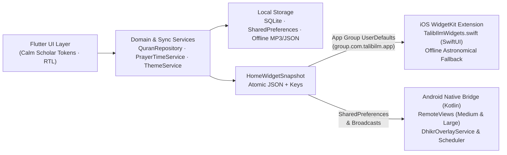

<div align="center">

  <a href="https://github.com/wacim-abdellli/talib_ilm">
    <picture>
      <source media="(prefers-color-scheme: dark)" srcset="assets/branding/lockup_on_dark.png" />
      <source media="(prefers-color-scheme: light)" srcset="assets/branding/lockup_on_light.png" />
      
    </picture>
  </a>

  <h1>طالب العلم — Talib Ilm</h1>

  <p>
    <strong>منظومة علمية إسلامية متكاملة لطالب العلم الشرعي والمسلم المعاصر</strong><br />
    <em>An Offline-First, High-Contrast Arabic Islamic Knowledge Suite built with Flutter, SwiftUI WidgetKit &amp; Kotlin</em>
  </p>

  <p>
    <a href="https://github.com/wacim-abdellli/talib_ilm/actions/workflows/verify.yml">
      
    </a>
    <a href="https://github.com/wacim-abdellli/talib_ilm/actions/workflows/build_ios.yml">
      
    </a>
    <a href="https://github.com/wacim-abdellli/talib_ilm/releases">
      
    </a>
  </p>

  <p>
    
    
    
    
    
  </p>

  <p>
    <a href="#-وصف-التطبيق--description">الوصف (Description)</a> •
    <a href="#-القدرات-والميزات-الأساسية--core-capabilities">الميزات</a> •
    <a href="#-المعمارية-التقنية--architecture">المعمارية</a> •
    <a href="#-التحميل-والتثبيت--downloads--installation">التحميل والتثبيت (APK / IPA)</a> •
    <a href="#-بوابة-الجودة-وبناء-الإنتاج--ci-gates--development">بناء المطورين</a>
  </p>

</div>

---

## 📌 وصف التطبيق | Description

### العربية
**تطبيق «طالب العلم»** هو بيئة علمية وعبادية رقمية شاملة ومستقلة تعمل بمنهجية **العمل دون إنترنت أولاً (Offline-First)**، صُمّمت خصيصاً لطالب العلم الشرعي والقارئ المسلم باللغة العربية الكاملة (`RTL-First`). يجمع التطبيق بين التأصيل العلمي المنهجي — عبر سُلّم متون طالب العلم، والمكتبة الشاملة، وموسوعة **12,075+** درة من أقوال السلف وأئمة الإسلام، و**4,608+** أحاديث نبوية مخرّجة، وبنك **1,180** سؤالاً تأصيلياً — وبين مصحف المدينة النبوية المتكامل بالخط العثماني (QCF)، ومنظومة مواقيت الصلاة والأذان الدقيقة المزوّدة بودجات أصلية تفاعلية لنظامي **iOS (`WidgetKit`)** و**Android (`RemoteViews`)** في المظهرين الفاتح والداكن.

تم بناء الواجهة بالكامل فوق نظام التصميم التراثي الهادئ **«Calm Scholar»**، الذي يوازن بين وضوح النصوص وتباينها المعياري الصارم (`WCAG AA ≥ 4.5:1`)، وبين أداء **60 إطاراً في الثانية** في تصفح المصحف والتنقل والبحث الصوتي والنصي دون تعقيد أو إعلانات أو تشتيت.

### English
**Talib Ilm (طالب العلم)** is a production-grade, Arabic-first (`RTL`) Islamic scholarship and daily worship suite engineered with **Flutter**, native **SwiftUI (`WidgetKit`)**, and **Kotlin (`RemoteViews` & `WindowManager`)**. Built around an **Offline-First** architecture and the **Calm Scholar** design system, it unifies a 60fps 604-page Madinah Mushaf, Hifdh repetition tooling, a tiered Islamic curriculum (11 disciplines with 1,180 sourced questions), 12,075+ attributed Salaf scholarly quotes, 4,608+ verified Hadiths, 159 live Quran radio streams, an astrolabe Qibla compass, autonomous native iOS & Android home screen prayer widgets (full Light & Dark mode parity), and a transient active-usage Dhikr overlay engine with zero persistent notification clutter.

> قال رسول الله ﷺ: **«مَنْ سَلَكَ طَرِيقًا يَلْتَمِسُ فِيهِ عِلْمًا سَهَّلَ اللَّهُ لَهُ بِهِ طَرِيقًا إِلَى الْجَنَّةِ»** — *رواه مسلم*

---

## ✨ القدرات والميزات الأساسية | Core Capabilities

| القسم | الوصف المنهجي والمعماري | أبرز الأرقام |
| :--- | :--- | :--- |
| **📖 القرآن الكريم ومصحف المدينة** | مصحف المدينة الأصيل بخطوط QCF المحمّلة مسبقاً، تلوين أحكام التجويد، التفاسير (الميسر، السعدي، ابن كثير)، تبويب **المتشابهات والضوابط الحفظية**، ومقاصد السور مع القفز الفوري للآيات. | `604` صفحة · `43+` قارئ · `3` ثيمات مصحف |
| **🔁 محرك التحفيظ والتلاوة** | تحكّم متكامل بالتكرار للآيات والمقاطع (`HifdhAudioRangeHelper`) حتى للقراء ذوي السور الكاملة، مؤقّت نوم ذكي، تحكم شاشة القفل (`just_audio_background`)، وتنزيل أوفلاين للسور. | دعم التلاوة المفصلة والكاملة أوفلاين |
| **📚 سُلّم المتون والمكتبة العلمية** | تأصيل منهجي متدرج عبر **11 فنّاً شرعياً**، قارئ متون وشروح بخطوط عربية تراثية مع حفظ تلقائي للموضع، مشغل صوتي مصغر مستمر (`Mini Player`)، وحقيبة لإدارة المحتوى المحمّل. | `11` فنّاً · `18+` متناً مدمجاً · بحث متجاهل للتشكيل |
| **💎 موسوعة درر السلف** | قاعدة آثار وأقوال محققة ومعزوة لمصادرها (حلية الأولياء، سير أعلام النبلاء، وغيرها) عبر طبقات الصحابة والتابعين وأئمة السلف وعلماء العصر مع بطاقات مشاركة منسّقة. | `12,075` درة وأثر موثق |
| **📜 واحة الحديث النبوي** | موسوعة أحاديث مصنّفة موضوعياً مع بيان الراوي والحكم والتخريج العلمي الدقيق وإمكانية البحث والنسخ والمشاركة. | `4,608` حديثاً مصنّفاً |
| **🕌 مواقيت الصلاة والودجات** | حساب فلكي دقيق (`adhan` + `geolocator`) مع **آلة حالات خماسية (5-Phase State Machine)** للإقامة والأذان والجمعة، وودجات أصلية في **SwiftUI** و**Kotlin** للمظهرين الفاتح والداكن. | أحجام `Medium 4×1` و`Large 4×2` |
| **🔔 لحظة ذكر الذكية (Android)** | بطاقة ذكر عائمة تظهر فقط أثناء الاستخدام الفعلي للهاتف أو بعد فتح القفل عبر خدمة عابرة (`Transient Foreground + AlarmManager`) دون تثبيت أي إشعار دائم مزعج. | `5` أقسام منوعة بتدوير غير متكرر |
| **🏆 بنك الأسئلة والتحدي اليومي** | اختبارات علمية مؤصلة بمستويات متدرجة وتحدٍ يومي، مدعومة بالتعليل العلمي والشرح والدليل من الكتاب والسنة لكل مسألة. | `1,180` سؤالاً شرعياً (`v2.0.0`) |
| **🧭 القبلة والأذكار والإذاعات** | بوصلة قبلة أسطرلابية فورية بالمدينة أو الموقع، أذكار الصباح والمساء وما بعد الصلاة، سبحة رقمية بحفظ التقدم، وبث حي لإذاعات القرآن الكريم. | `159` إذاعة قرآنية مباشرة |

<details>
<summary><strong>🔍 تفاصيل هندسية متقدمة للمطورين (Deep-Dive Engineering Highlights)</strong></summary>

1. **Zero-Jank 60fps Mushaf Navigation (`lib/features/quran/`)**:
   - Pre-warms `QuranRepository` word offsets and `QcfFontLoader` target page glyphs *before* route transitions complete, eliminating frame-0 spinner flicker.
   - Replaces async debounced recognizer allocation inside `QuranLine` with single-pass synchronous recognizer construction paired with `PageView` implicit scrolling and `SchedulerBinding` post-frame callbacks.
   - Decoupled Mushaf reading modes (**Classic White**, **Warm Sepia**, **Warm AMOLED Obsidian `#080706`**) persisted independently of global app appearance.
2. **Cross-Platform Widget Synchronization (`HomeWidgetSnapshot` ↔ `TalibIlmWidgets.appex` & `RemoteViews`)**:
   - Atomically snapshots prayer epoch timestamps, active phase (`preAdhan`, `atAdhan`, `betweenAdhanAndIqama`, `inSalah`, `postSalah`), custom mosque Iqama intervals, Hijri dates, city coordinates, and theme resolution keys into JSON payloads (`prayer_data_json`) + App Group `UserDefaults` (`group.com.talibilm.app` with provisioning-profile discovery for AltStore/Sideloadly).
   - Native SwiftUI widget (`TalibIlmWidgetEntryView`, `MediumPrayerWidgetView`, `LargePrayerWidgetView`) enforces physical LTR-ordered prayer columns for correct Arabic visual reading order, live `.timer` countdowns, dynamic `@Environment(\.colorScheme)` + explicit full-bleed `ZStack` / `.containerBackground(for: .widget)` Light & Dark rendering, plus a full **MEEUS offline astronomical fallback calculator** when App Group snapshots age past midnight.
3. **Resilient Background Notifications & Native Sound Routing**:
   - Dedicated iOS `.caf` audio assets (`ios/Runner/NotificationSounds/`) copied across root, `Library/Sounds/`, and `NotificationSounds/` in CI for Time-Sensitive notifications even with hardware silent toggles evaluated.
   - Android `SafeNotificationBootReceiver`, `DhikrOverlayScheduler`, and transient `DhikrOverlayService` decouple unlock/screen-on broadcasts from permanent notification clutter.
4. **Arabic Diacritic-Insensitive Indexing (`ArabicSearchUtils`)**:
   - Normalizes Tashkeel, Tatweel, Alef/Ya/Ta-Marbuta variants in real time across Quran ayahs, Hadiths, Salaf gems, and Mutun books.

</details>

---

## 🏗️ المعمارية التقنية | Architecture



### هيكل المشروع | Directory Layout

```text
talib_ilm/
├── .github/workflows/
│   ├── verify.yml                  # 7-Gate release readiness CI (analyze, strict lint, tests, APK, AAB, signing)
│   └── build_ios.yml               # macOS runner: IPA + embedded TalibIlmWidgets.appex + .caf sounds + Releases
├── android/                        # Kotlin native widgets, BootReceiver, DhikrOverlayService & WindowManager UI
├── ios/
│   ├── Runner/                     # AppDelegate, Info.plist, NotificationSounds (*.caf), entitlements
│   └── TalibIlmWidgets/            # Native SwiftUI WidgetKit extension (TalibIlmWidgets.swift, TalibIlmWidgetViews.swift)
├── assets/
│   ├── branding/                   # Light/dark lockups, monochrome icons, iOS 1024px & adaptive badges
│   ├── data/                       # Hadith, Salaf gems, Quiz bank v2, Adhkar, Radios, Mutun & Quran metadata
│   ├── fonts/                      # Cairo (400-800), Amiri (400/700), ScheherazadeNew (400/700)
│   └── audio/                      # Bundled local audio & Adhan assets
├── lib/
│   ├── app/                        # Design tokens (AppPalette, AppTextTheme, AppSpacing, AppRadius, AppMotion), constants
│   ├── core/                       # Audio, Adhan scheduling, HomeWidget sync, Location, Dhikr Moment, Search utils
│   ├── features/                   # Feature modules (home, quran, ilm, prayer, adhkar, hadith, salaf_gems, radio, favorites...)
│   └── shared/                     # Shared RTL navigation (FadePageRoute + iOS edge-swipe), animations, UI primitives
├── packages/qcf_quran_plus/        # Vendored Madinah Mushaf glyph package tuned for Dart 3.10+
└── tool/                           # ui_lint_v2.py, contrast.py, fail-closed signing & readiness verification scripts
```

---

## 🎨 نظام التصميم وجودة الوصول | Design System ("Calm Scholar")

| المعيار | التطبيق الفعلي في الكود |
| :--- | :--- |
| **لوحة الألوان المزدوجة** | **الوضع الفاتح**: رق عاجي دافئ (`#FAF8F5`) وأسطح نقية (`#FFFFFF` / `#F0ECE1`) مع كهرمان ذهبي عتيق.<br>**الوضع الداكن (AMOLED)**: أوبسيديان دافئ (`#090807`) في التطبيق و(`#070707`) في الودجات لراحة العين ليلاً. |
| **التباين القياسي (WCAG AA)** | مُتحقّق آلياً عبر `tool/contrast.py`: تباين النصوص `≥ 4.5:1` والأيقونات/الحدود `≥ 3.0:1`. |
| **انضباط التوكنز (UI Lint v2)** | فحص آلي صارم (`python tool/ui_lint_v2.py --strict`) يمنع الألوان أو الخطوط أو المسافات العشوائية خارج `lib/app/theme/`. |
| **الخطوط والوصول** | خطوط `Cairo` و`Amiri` و`ScheherazadeNew`، حد أدنى للمس `48dp`، حجم خط أدنى `12sp`، واجتياز تكبير الخطوط حتى `2.0x` دون Overflow. |
| **سلاسة السحب والانتقال** | دعم أصلي لإيماءة الرجوع بسحب حافة الشاشة في iOS (`CupertinoRouteTransitionMixin`) وحركات موحدة عبر `AppSectionSwitcher`. |

---

## 📦 التحميل والتثبيت | Downloads & Installation

### 🍎 iOS (`.ipa` لنظام آيفون — يدعم الودجات والأذان)
تُبنى حزمة iOS تلقائياً عبر **GitHub Actions** (`build_ios.yml`) متضمنةً امتداد الودجت `TalibIlmWidgets.appex` وملفات الصوت `.caf` الجاهزة للإشعارات الحساسة للوقت:
1. حمّل أحدث ملف `talib_ilm_ios.ipa` من صفحة **[GitHub Releases](https://github.com/wacim-abdellli/talib_ilm/releases)** (أو من قسم Artifacts داخل أحدث تشغيل ناجح لـ **[Build iOS App](https://github.com/wacim-abdellli/talib_ilm/actions/workflows/build_ios.yml)**).
2. ثبّت التطبيق على جهازك عبر **AltStore** أو **SideStore** أو **Sideloadly** (يدعم التطبيق اكتشاف معرف App Group ديناميكياً من ملف الـ Provisioning لضمان عمل الودجت حتى عند التثبيت الجانبي).

### 🤖 Android (`.apk` و `.aab`)
يمكن تحميل الإصدارات المبنية أو توليدها محلياً لكل فئات الأجهزة:
- **للهواتف الحديثة (`64-bit arm64-v8a`)**: حجم أخف وأداء أمثل (`flutter build apk --release --split-per-abi` أو `--target-platform android-arm64`).
- **للهواتف القديمة (`32-bit armeabi-v7a`)**: دعم مخصص للمعالجات القديمة عبر `--target-platform android-arm`.
- **الحزمة الشاملة (`Universal APK`) / حزمة المتجر (`AAB`)**: عبر `flutter build apk --release` و `flutter build appbundle --release`.

---

## 🚀 التطوير وبوابة التحقق الآلي | CI Gates & Development

### المتطلبات والتشغيل المحلي
```bash
# 1. استنساخ المستودع
git clone https://github.com/wacim-abdellli/talib_ilm.git
cd talib_ilm

# 2. تثبيت التبعيات
flutter pub get

# 3. التشغيل المحلي
flutter run
```

### بوابات التحقق السبع في CI (`.github/workflows/verify.yml`)
يفرض خط التكامل المستمر سبع بوابات آلية متتالية قبل اعتماد أي إصدار:

| البوابة | الأمر المنفّذ | الغرض الهندسي |
| :--- | :--- | :--- |
| **Gate 1 — Static Analysis** | `flutter analyze --no-pub` | ضمان خلو المشروع من أي أخطاء أو تحذيرات ساكنة |
| **Gate 2 — UI Strict Lint** | `python tool/ui_lint_v2.py --strict` | منع كسر نظام التوكنز واستخدام قيم خام خارج `lib/app/theme/` |
| **Gate 3 — Test Suite** | `flutter test --no-pub` | التحقق من المنطق الصوتي، المصحف، المواقيت، الأسئلة، والودجات |
| **Gate 4 — Tool Regressions** | `python tool/test_release_readiness_checks.py` | اختبارات انحدار لأدوات التحقق والسكربتات |
| **Gate 5 — Debug APK Build** | `flutter build apk --debug --no-pub` | التأكد من سلامة تجميع Android وGradle |
| **Gate 6 — Release AAB Check** | `python tool/run_release_readiness_checks.py --only-bundle` | فحص بناء حزمة الإصدار وتوافق التوقيع |
| **Gate 7 — Fail-Closed Signing** | `python tool/verify_android_signing_fail_closed.py` | منع بناء Release بمفاتيح اختبارية أو إعدادات غير آمنة |

---

## 🤝 المساهمة والترخيص | Contributing & License

- **المساهمة**: نرحب بمساهمات المطورين والمصححين في التحسينات المنهجية أو البصرية مع الالتزام التام بقواعد `AGENTS.md` و`DESIGN_SYSTEM.md` واجتياز البوابات السبع في CI.
- **الترخيص**: متاح كوقفٍ ومشروعٍ مفتوح المصدر لنفع طلاب العلم والمسلمين حول العالم.

<div align="center">
  <br />
  <sub><strong>نسأل الله أن ينفع بهذا العمل وأن يجعله خالصاً لوجهه الكريم</strong></sub><br />
  <sub>Built with care for students of Sacred Knowledge</sub>
</div>
