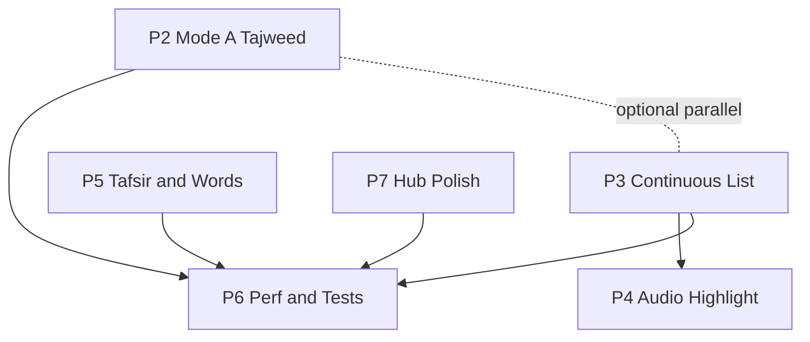

# Quran Feature — Agent Handoff Rapport

**Project:** talib_ilm  
**Scope:** `lib/features/quran/` (+ `lib/core/utils/`, `lib/app/theme/` only where design tokens are required)  
**Mission:** Audit & elevate the Holy Quran section to gold-standard excellence (King Fahd Medina Mushaf UX, Wahy-class features, 60fps, Arabic-Indic digits, lightweight).  
**Audience:** Implementation agent (strict execution; one phase per session unless owner says otherwise).

---

## 1. Mandatory reads before any work

1. `AGENTS.md` (repo root)  
2. `DESIGN_SYSTEM.md`  
3. `UI_PROGRESS.md`  
4. This file (`docs/QURAN_AGENT_RAPPORT.md`)

**Default rule from AGENTS.md:** visual layer only — **unless** executing this Quran mission (services, API, prefs, gestures, audio, tajweed, tafsir are in scope).

---

## 2. Gold spec summary (owner requirements)

### 2.1 Dual-mode reader

| Mode | Requirement |
|------|-------------|
| **A — Authentic 604-page Mushaf** | 15-line Medina layout, QCF per-page fonts, surah headers, Basmalah, page header/footer frame |
| **B — Ayah list** | Continuous vertical scroll, tajweed letter coloring, optional English translation, tafsir in sheets |
| **Sync** | 100% position sync (surah, ayah, page) when switching modes |

### 2.2 Gestures & physics

- Horizontal `PageView`: `BouncingScrollPhysics(parent: AlwaysScrollableScrollPhysics())`.
- **Never** wrap `PageView` in outer `InkWell` or greedy gesture recognizers.
- Drag/swipe must **not** trigger verse tap, sheet, or audio.
- Margin/header/footer tap → toggle immersive overlays.
- Verse tap/long-press → `HapticFeedback.selectionClick()` / medium on long-press → highlight → Ayah Details sheet.

### 2.3 Mode A framing

- **Header:** right `سُورَةُ [الاسم]`, center `۞`, left `الجُزْءُ [الاسم]`; gold divider below.
- **Footer:** center `ـ ٤٢ ـ` (Arabic-Indic page number); gold divider above.
- **Surah start banner:** ornamental frame; dark = obsidian `#1A1D23`, double gold border `#997D3D`, title `#F5D78E`; sepia/white = parchment + bronze/charcoal. No light cream bitmaps in dark mode.
- Basmalah after banner (except At-Tawbah).

### 2.4 Tajweed (6-rule palette)

When **تلوين أحكام التجويد** ON:

| Rule | Hex |
|------|-----|
| Ghunnah mushaddadah | `#B45309` |
| Qalqalah | `#0284C7` |
| Ikhfaa | `#059669` |
| Idgham | `#7C3AED` |
| Iqlab | `#EA580C` |
| Madd | `#DC2626` |

OFF → classical black/charcoal per mushaf theme.  
Mode A: colored tajweed rendering (gap vs spec — see P2). Mode B: letter-accurate coloring.

### 2.5 Settings sheet

- Bottom padding: `EdgeInsetsDirectional.only(bottom: AppSpace.xxl + 48)`.
- Mode/theme cards: active border + checkmark.
- Reciter & tafsir: bordered pills + dropdown icons.

### 2.6 Audio & tafsir

- Mini-player: play/pause, prev/next, reciter, background audio where supported.
- Active ayah highlight synced with audio in both modes.
- Tafsir scholars: الميسر، السعدي، ابن كثير، البغوي (+ English option as product allows).

### 2.7 Code quality

- Every file **&lt; 600 lines** — split into `_overlays`, `_settings`, `_page`, etc.
- **Token compliance:** no raw `Color(...)`, `Colors.*` (except transparent), raw `TextStyle(`, `fontSize`, numeric `Duration`, etc. outside `lib/app/theme/`.
- RTL: `EdgeInsetsDirectional`, `AlignmentDirectional`, `PositionedDirectional`.
- `flutter analyze` → 0 errors, 0 warnings, 0 hints (target).

### 2.8 Verification checklist (manual + automated)

- [ ] 10-page horizontal swipe: zero jank, no accidental ayah sheet  
- [ ] Dark mode: Al-Baqarah, ~page 50, Al-Fatihah — surah banners AAA (&gt;7:1)  
- [ ] Every page: surah name (right), juz (left), Arabic-Indic page number (bottom)  
- [ ] Tajweed toggle ON/OFF matches legend  
- [ ] `WakelockPlus` while reading  
- [ ] Last surah/ayah/page restored on reopen  
- [ ] `flutter analyze` 0 issues  

---

## 3. Current baseline (as of last handoff update)

**Do not re-litigate completed work unless regressions found.**

### 3.1 Structure (premium reader stack)

| Area | Status | Key paths |
|------|--------|-----------|
| Dual-mode shell | Done | `presentation/widgets/mushaf_page_viewer.dart` |
| Mode A QCF 604 | Strong | `mushaf_single_page.dart`, `qcf_quran` |
| Mode B list | **Partial** | `quran_ayah_list_view.dart` — **per-surah only**, not full Quran |
| Gestures | Improved | `presentation/utils/mushaf_verse_gestures.dart` |
| Overlays / chrome | Strong | `mushaf_reader_overlays.dart`, Arabic-Indic via `lib/core/utils/arabic_digits.dart` |
| Tajweed Mode B + sheet | Improved | `tajweed_service.dart`, `tajweed_verse_service.dart` (Quran.com `text_uthmani_tajweed`) |
| Tajweed Mode A | **Open** | QCF fonts have no per-glyph tajweed |
| Settings | Done | `mushaf_settings_sheet.dart`, bottom padding spec |
| Prefs central | Done | `data/services/quran_reader_preferences.dart` |
| Tafsir | Fixed IDs | `quran_tafsir_service.dart` — see §3.2 |
| Audio | Partial | `quran_audio_service.dart`, bottom bar |
| Wakelock | Wired | `mushaf_page_viewer.dart` |
| Last read | Partial | `BookmarkService` + prefs; cold-start precedence may need P6 |

### 3.2 Tafsir — Quran.com v4 resource IDs (verified)

| Scholar | Enum | API ID |
|---------|------|--------|
| التفسير الميسر | `TafsirScholar.muyassar` | 16 |
| تفسير السعدي | `TafsirScholar.saadi` | **91** (was wrongly 14) |
| تفسير ابن كثير (عربي) | `TafsirScholar.ibnKathir` | **14** (was wrongly 170) |
| تفسير البغوي | `TafsirScholar.baghawi` | 94 |
| English Ibn Kathir | `TafsirScholar.englishIbnKathir` | 169 |

Persistent cache key prefix: **`tafsir_v2_`** (invalidates pre-fix wrong-ID cache).

**Verify endpoint:** `GET https://api.quran.com/api/v4/resources/tafsirs`  
**Never change IDs without re-verifying that list.**

### 3.3 Tajweed markup source

- API: `GET .../verses/by_chapter/{surah}?fields=text_uthmani_tajweed`
- Parser: `TajweedService.buildVerseSpans` / `buildMarkupSpans`
- Tests: `test/tajweed_markup_test.dart`, `test/arabic_digits_test.dart`

### 3.4 Gap matrix vs gold spec

| Area | Status |
|------|--------|
| Mode A Medina QCF | Strong |
| Mode B continuous full Quran | **Not done** |
| Mode switch sync | Improved (page jump on return to mushaf) |
| Page swipe vs ayah tap | Improved (movement-aware recognizers) |
| Tajweed Mode B | API markup + offline heuristics |
| Tajweed Mode A | **Largest gap vs Wahy** |
| Arabic-Indic digits | Shared util + reader chrome |
| Full Wahy feature set | Search, mushaf tajweed fonts, cross-surah list, rich word-by-word |

---

## 4. Global execution rules (every phase)

| Rule | Strict action |
|------|----------------|
| One phase per session | Branch: `ui/r-quran-p<n>-<slug>` (or team convention) |
| Max ~25 files changed | If exceeded → stop; report `CONTINUE FROM P<n> step k` |
| File length | Split any file &gt;600 lines in **separate commit first** |
| Verification (mandatory) | `flutter analyze` · `python tool/ui_lint_v2.py` · `flutter test` (named tests) · `flutter build apk --debug` |
| Git safety | No `git clean`; no delete unlisted files; commit only when user asks |
| Honesty | Record failures/skips in `UI_PROGRESS.md` → Open issues |
| Arabic strings | Do not change Quran Arabic content except verified bug + owner sign-off |
| Digits | User-facing reader chrome: **Arabic-Indic** (`toArabicDigits`, `getArabicJuzName`) — not Indian digits |

### 4.1 Session report format (≤8 lines)

```text
Phase · branch · commits · files changed · lint v2 before→after · analyze/tests/build (actually run) · manual checks · open issues / owner actions
```

### 4.2 Session kickoff template (copy-paste)

```text
MISSION: Quran P<n> — <title>
Branch: ui/r-quran-p<n>-<slug>
Read first: AGENTS.md, DESIGN_SYSTEM.md, UI_PROGRESS.md, docs/QURAN_AGENT_RAPPORT.md
Implement: P<n> steps 1..k only (stop at 25 files)
Verify: flutter analyze; python tool/ui_lint_v2.py; flutter test <listed>; flutter build apk --debug
Manual: <checklist from phase section>
Report: <format §4.1>
CONTINUE FROM P<n> step k+1 if truncated
```

---

## 5. Phase roadmap — strict actions

**Recommended execution order:** **P3 → P4 → P2 → P5 → P6 → P7**  
(Rationale: continuous list unlocks Wahy-class UX and audio scroll; Mode A tajweed is hardest; hub polish last.)



---

## P0 — Tafsir IDs, Baghawi, reader prefs (DONE)

**Status:** Complete. Do not redo unless regression.

- Fixed Sa'di / Ibn Kathir ID swap  
- Added Baghawi (94)  
- `QuranReaderPreferences` single source; viewer wired  
- Tajweed markup engine for list + ayah sheet  

---

## P1 — Mode B tajweed via Quran.com (DONE)

**Status:** Complete for per-surah list + details sheet.

- `TajweedVerseService` + `TajweedService.buildVerseSpans`  
- Offline heuristic fallback  

**Remaining:** full-Quran list (P3) must reuse same services — no second parser.

---

## P2 — Mode A Tajweed (604-page QCF)

### Goal

When **تلوين أحكام التجويد** is ON, Mode A shows 6-color tajweed **without** breaking 15-line QCF layout, page swipe, or ayah tap discrimination.

### Architecture decision (document choice in PR)

QCF fonts (`qcf_quran`) are **not** tajweed-colored.

| Option | Description | Risk | Recommendation |
|--------|-------------|------|----------------|
| **A1 Hybrid overlay** | Keep QCF when tajweed OFF; when ON use `text_uthmani_tajweed` + sacred font spans instead of `getVerseQCF` | Line count may drift vs printed mushaf | **Ship first (P2a)** |
| **A2 Tajweed mushaf asset pack** | Bundled tajweed QCF/TTF per page | Size, licensing | **P2b long-term gold** |
| **A3 Page images** | Quran.com images + hit regions | Heavy, not vector | Defer |

**Strict action:** Implement **A1** first; if layout differs, add settings UX label (e.g. عرض التجويد — نص عثماني). Spike **A2** in documentation only unless assets exist.

### Dependencies

- Extend or add page-level markup: **`TajweedPageService`** — page → `(surah, ayah) → markup` via `quran.getPageData` + API batch/cache  
- Reuse `TajweedService.buildVerseSpans` — **no duplicate parsers**  
- `MushafSinglePage._buildQcfPage` — branch on `isTajweedEnabled`

### File-level plan

| Action | Path |
|--------|------|
| **Add** | `lib/features/quran/data/services/tajweed_page_service.dart` |
| **Modify** | `lib/features/quran/presentation/widgets/mushaf_single_page.dart` |
| **Modify** | `lib/features/quran/presentation/widgets/mushaf_page_viewer.dart` (prefetch n±1) |
| **Optional add** | `lib/features/quran/presentation/widgets/mushaf_tajweed_verse_line.dart` (&lt;200 lines) |

### Strict step sequence

1. Spike pages **1, 2, 50, 604**: QCF vs Uthmani markup line count — screenshot + PR note.  
2. Implement `TajweedPageService` (memory + optional prefs chunk `tajweed_page_v1`; offline fallback heuristics).  
3. Wire dual render in `MushafSinglePage`; preserve banner + basmalah QCF where spec requires.  
4. Tajweed OFF = unchanged QCF; ON = `TajweedPalette` / legend colors.  
5. Prefetch current page ±1 on page change (debounced).  
6. Profile: 10 horizontal swipes — no jank; keep `RepaintBoundary` per page.

### Acceptance criteria

- [ ] Toggle OFF: pixel-parity with current QCF mushaf (behavioral).  
- [ ] Toggle ON: six rules match `TajweedPalette` / `MushafTajweedLegendWidget`.  
- [ ] 10-page swipe: no accidental ayah sheet; header/footer toggle overlays.  
- [ ] Dark surah banners unchanged (AAA).  
- [ ] analyze + ui_lint_v2 clean on touched files.

### Out of scope (P2)

- Bundled tajweed QCF pack (P2b)  
- Tajweed on decorative basmalah QCF glyphs (optional polish)

---

## P3 — Mode B full-Quran continuous scroll + position sync

### Goal

Mode B = **one continuous vertical scroll** across all surahs, with juz/surah headers, optional translation, tajweed markup, **bi-directional sync** with Mode A (surah, ayah, **page**).

### Current gap

`QuranAyahListView` is single-surah only.

### Architecture

1. **`QuranAyahIndex`** — flat items: `SurahHeader | Basmalah | Ayah(surah, ayah, page) | JuzHeader?` built from `quran` package (6236 ayahs).  
2. **`QuranContinuousListView`** — replace list mode host in viewer.  
3. **Scroll sync:** `ItemScrollController` + positions listener — use `scrollable_positioned_list` **only if** owner approves dependency; else estimated heights + correction.  
4. **Persist:** extend `QuranReaderPreferences` / `BookmarkService.saveLastRead` with scroll index if needed.  
5. **Mode switch:**  
   - → Mushaf: `quran.getPageNumber(surah, ayah)` + `jumpToPage`  
   - → List: scroll to index for `(currentSurah, currentAyah)`

### File-level plan

| Action | Path |
|--------|------|
| **Add** | `lib/features/quran/data/models/quran_reader_index.dart` |
| **Add** | `lib/features/quran/presentation/widgets/quran_continuous_list_view.dart` |
| **Add** | `lib/features/quran/presentation/widgets/quran_section_header.dart` (reuse `MushafSurahBanner`) |
| **Modify** | `lib/features/quran/presentation/widgets/mushaf_page_viewer.dart` |
| **Modify** | `lib/features/quran/data/services/quran_reader_preferences.dart` (optional `lastScrollIndex`) |
| **Deprecate/redirect** | `quran_ayah_list_view.dart` after migration |

### Strict step sequence

1. Index generator + **unit tests**: 6236 ayahs; sample `getPageNumber` consistency.  
2. `ListView.builder` + stable keys `ValueKey('ayah_${surah}_$ayah')`.  
3. Tajweed: prefetch surah markups when surah enters viewport (`TajweedVerseService`).  
4. `onVisibleAyahChanged` → update viewer state + last read (throttle ~500ms).  
5. Mode enter: scroll-to current ayah; wire audio active-ayah listener (like current list).  
6. Translation: `showTranslation` + bundled or API (P5 may extend).

### Acceptance criteria

- [ ] Scroll Fatihah → Baqarah without surah picker.  
- [ ] Switch to mushaf at 2:255 → correct ~page 42.  
- [ ] Switch back to list → same ayah visible.  
- [ ] Tajweed toggle on visible ayahs.  
- [ ] Text scale 1.0 / 1.5 / 2.0 — no text overflow from fixed heights.  
- [ ] Each new file &lt;600 lines.

### Risks

- Scroll-to accuracy → prefer approved scroll-position package or two-pass layout.  
- Memory: **never** hold 6236 full markups in RAM — surah-scoped cache only.

---

## P4 — Audio, highlight sync, mini-player

### Goal

Mini-player (play/pause, prev/next, reciter); **active ayah highlight** in Mode A and Mode B; background audio where platform allows.

### Current state

- `QuranAudioService`, `MushafReaderBottomBar` exist.  
- `activeSurah` / `activeAyah` passed to `MushafSinglePage` — verify full-verse highlight.

### Strict actions

1. **Audit** `data/services/quran_audio_service.dart`: reciters, URLs, notifiers, auto-advance at ayah end.  
2. **Mushaf:** highlight entire ayah (text + marker) when active; theme-safe gold alpha (tokens).  
3. **P3 list:** scroll to active ayah on progress (debounced).  
4. **Background audio (P4b):** audit pubspec (`just_audio`, `audio_session`); implement or document gap.  
5. **Prev/next:** boundary-safe `playVerse(surah, ayah±1)`.

### Files

- `quran_audio_service.dart`  
- `mushaf_reader_overlays.dart`  
- `mushaf_single_page.dart`  
- `quran_continuous_list_view.dart` (after P3)

### Acceptance criteria

- [ ] Play from ayah sheet → highlight on mushaf without tap.  
- [ ] Product rule for manual page change while playing (follow audio vs stay) — implement per owner decision (§8).  
- [ ] No gesture conflict with `PageView`.  
- [ ] Reciter persists via `QuranReaderPreferences`.

---

## P5 — Tafsir, English translation, word-by-word

### Goal

Complete scholar tafsir; real word meanings; English translation where specified.

### Current state

- `QuranTafsirService` + cache v2  
- `AyahWordsTabView` — placeholder `getWordMeanings`  
- List translation via `quran.getVerseTranslation`

### Strict actions

1. **QA matrix:** each scholar × ayahs 1:1, 2:255, 112:1 — non-empty; log in service doc.  
2. **English translation:** new or extend service — Quran.com translation resource (e.g. Sahih International) by ayah; cache like tafsir.  
3. **Word-by-word:** `GET verses/by_key/{key}?words=true` → `quran_word_service.dart` → `AyahWordsTabView`.  
4. Settings default tafsir ↔ sheet (already partially wired — verify end-to-end).  
5. Improve `_cleanHtml` for API HTML entities/lists.

### Acceptance criteria

- [ ] Baghawi Arabic for 2:255.  
- [ ] Word tab ≥3 real glosses for 1:1.  
- [ ] Settings tafsir applies to next sheet open.  
- [ ] Network failure: graceful Arabic message, no crash.

---

## P6 — Performance, wakelock, persistence, automated QA

### Goal

60fps swipe, prefetch, cold-start last-read, wakelock, tests.

### Strict actions

1. **Cold start:** `MushafPageViewer.initState` — if no route args, load bookmark / `QuranReaderPreferences.lastPage` + surah/ayah. **Precedence:** route args &gt; bookmark &gt; page pref (document in code comment).  
2. **Wakelock:** verify manual checklist; optional widget test note.  
3. **Prefetch:** mushaf pages n±1 (P2); list surahs ±1 viewport.  
4. **Tests:** expand `tajweed_markup_test.dart`; add `quran_reader_index_test.dart`; golden `MushafSurahBanner` if harness exists.  
5. **Manual device script** (attach to PR): 10-page swipe, dark banners, tajweed toggle, wakelock 2min, kill app → restore position.

### Acceptance criteria

- [ ] All verification commands green.  
- [ ] Optional: unit test for gesture pool movement threshold (tap rejected on drag).

---

## P7 — Hub & satellite screens

### Goal

`quran_page.dart`, bookmarks, quick jump, stats, cards — tokens, RTL, Arabic-Indic, 48dp targets.

### Inventory strict pass

| File | Action |
|------|--------|
| `presentation/quran_page.dart` | Navigate to reader with last-read args |
| `bookmarks_page.dart`, `quran_bookmarks_tab_view.dart` | Open at bookmark; Arabic-Indic |
| `quick_jump_sheet.dart` | Page/surah/juz; sync prefs |
| `surah_card.dart`, `juz_card.dart` | Token compliance |
| `quran_stats_banner.dart` | Digits + contrast |
| `data/quran_api_service.dart` | Touch only if P5 requires; avoid drive-by refactor |

One audit session: grep forbidden UI patterns under `presentation/` (excluding completed reader widgets).

### Acceptance criteria

- [ ] Hub → reader → back stack correct.  
- [ ] ui_lint_v2 on touched files.  
- [ ] Min 48dp tap targets on hub.

---

## 6. Strict “DO NOT” list

- Do **not** wrap horizontal `PageView` in greedy tap targets.  
- Do **not** use Indian digits in reader chrome.  
- Do **not** change tafsir IDs without verifying `/api/v4/resources/tafsirs`.  
- Do **not** add &gt;10 `// ui-lint: allow` repo-wide.  
- Do **not** claim full Wahy parity until P2 A2 or accepted A1 with UX disclaimer.  
- Do **not** change &gt;25 files in one session without stop + CONTINUE note.  
- Do **not** run `git clean` or delete unlisted files.

---

## 7. File map (`lib/features/quran/`)

```text
data/
  models/quran_models.dart
  services/
    bookmark_service.dart
    edition_service.dart
    quran_audio_service.dart
    quran_cache_service.dart
    quran_page_service.dart
    quran_reader_preferences.dart      ← prefs SSOT
    quran_sync_service.dart
    quran_tafsir_service.dart          ← tafsir IDs §3.2
    reading_stats_service.dart
    tajweed_service.dart               ← markup + heuristics
    tajweed_verse_service.dart         ← by surah API
    [P2] tajweed_page_service.dart
    [P5] quran_word_service.dart
  quran_api_service.dart
  database/quran_database.dart
presentation/
  quran_page.dart
  bookmarks_page.dart
  widgets/
    mushaf_page_viewer.dart            ← dual-mode shell
    mushaf_single_page.dart          ← Mode A
    mushaf_reader_overlays.dart
    mushaf_settings_sheet.dart
    mushaf_settings_widgets.dart
    quran_ayah_list_view.dart        ← legacy per-surah list
    [P3] quran_continuous_list_view.dart
    ayah_details_sheet.dart
    ayah_details_tabs.dart
    quick_jump_sheet.dart
    surah_card.dart, juz_card.dart
    quran_stats_banner.dart
    ...
presentation/utils/
  mushaf_verse_gestures.dart
```

**Shared:** `lib/core/utils/arabic_digits.dart`  
**Theme:** `lib/app/theme/app_palette.dart` (`TajweedPalette`, `MushafColors`)

---

## 8. Open product decisions (owner / PM)

Agent must **not guess** — pick default in PR description if blocked:

1. Mode A tajweed ON with layout drift — acceptable with label **عرض التجويد (نص عثماني)** vs require asset pack?  
2. While audio plays, user swipes mushaf — **follow audio page** vs **stay on user page**?  
3. English tafsir in main settings dropdown vs sheet-only?  
4. Approve dependency **`scrollable_positioned_list`** for P3 yes/no?

---

## 9. Verification commands (reference)

```bash
flutter analyze
python tool/ui_lint_v2.py
flutter test test/tajweed_markup_test.dart test/arabic_digits_test.dart
# After P3:
flutter test test/quran_reader_index_test.dart
flutter build apk --debug
```

---

## 10. Changelog for this rapport

| Date | Change |
|------|--------|
| 2026-10-12 | Initial agent handoff: gold spec, baseline P0/P1, phases P2–P7, execution rules, file map, owner decisions |

---

*End of rapport. Implementation agent: start with **P3 step 1** unless owner reprioritizes to P2.*
